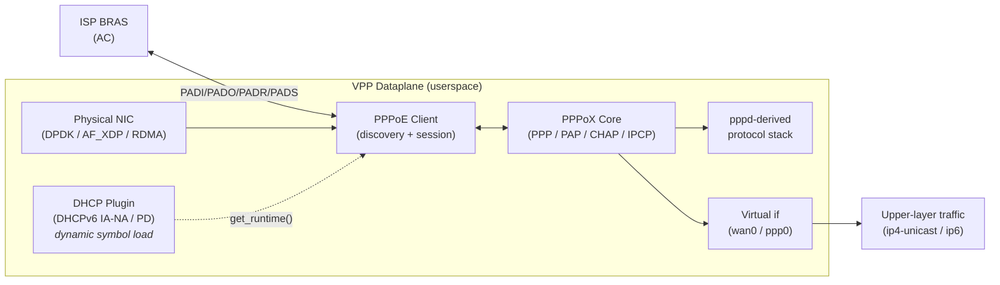

# 🚀 VPP PPPoE Client Plugin

[](https://github.com/Hi-Jiajun/vpp-pppoeclient/stargazers)
[](https://github.com/Hi-Jiajun/vpp-pppoeclient/network/members)
[](https://github.com/Hi-Jiajun/vpp-pppoeclient/releases/latest)
[](./LICENSE)

**A userspace PPPoE client plugin for the [FD.io VPP](https://fd.io/) dataplane** — RFC 2516 discovery & session lifecycle, PAP/CHAP-MD5 authentication, IPCP / IPv6CP negotiation, DHCPv6-PD, VLAN / QinQ / wildcard sub-interfaces and TCP MSS clamping. One process drives many concurrent PPPoE sessions.

> **📄 Where is the source code?** This `main` branch holds the README, the packaging scripts and the CI workflows. **The plugin source tree lives on the [`master` branch](https://github.com/Hi-Jiajun/vpp-pppoeclient/tree/master)** — its root is `CMakeLists.txt`, `pppoeclient.c`, `pppox/`, ... mirroring the upstream VPP `src/plugins/` layout. Development happens on [`Hi-Jiajun/vpp@feat/pr-pppoeclient`](https://github.com/Hi-Jiajun/vpp/tree/feat/pr-pppoeclient/src/plugins/pppoeclient), the working branch for upstream FD.io Gerrit review.
>
> 📘 **[English README →](./README_EN.md)**

> 为 [FD.io VPP](https://fd.io/) 数据面设计的用户态 PPPoE 客户端插件。
> 在 VPP 的高性能 vectorized packet processing 基础上完整实现 RFC 2516 PPPoE
> 发现/会话生命周期、PAP/CHAP 认证、IPv4/IPv6 地址协商，单进程可管理大量并发 PPPoE 会话。

🌏 [English README](./README_EN.md)

---

## ✨ 核心特性

- **用户态原生实现**：完全跑在 VPP 数据面，避开传统 `pppd` + kernel tunnel 的 context switch 开销
- **单插件整合**：PPPoE 发现、PPPoX 控制面、PAP/CHAP-MD5 认证（最长支持 255 字节用户名/密码）、IPCP/IPv6CP 协商合并为 `pppoeclient_plugin.so`
- **VLAN / QinQ 与通配子接口**：数据面支持单层 VLAN、QinQ（802.1ad/802.1q）及 wildcard / `default` 子接口的会话 VLAN 自动学习与 `O(1)` bihash 分发
- **TCP MSS Clamping 与 MTU 上限协商**：自动修正 TCP MSS 避免分片，LCP/IPCP 按 `configured_mtu`（默认 1492）约束协商 MTU
- **多实例并发**：每个 PPPoE 会话用独立 `sw-if-index` 虚拟接口承载，支持同时跑多路拨号
- **DHCPv6-PD 集成**：通过 `vlib_get_plugin_symbol` 动态加载 `dhcp` 插件的 `*_get_runtime()` 接口，`show pppoe client detail` 直接展示 DHCPv6 IA-NA 地址和 PD 前缀租约状态（需宿主 VPP 含 `dhcp6_*_get_runtime` 导出补丁，见下方预编译包说明）
- **会话持久化 + 可靠 PADT**：会话 ID 和 AC MAC 原子写入文件；进程退出时通过 raw AF_PACKET socket 直接发 PADT，不依赖 VPP 数据面路径，确保可靠断线
- **一步创建与动态去配置**：`create pppoe client` 支持在创建时一步传入凭据、MTU/MRU、超时、默认路由与 DNS 参数；`set pppoe client` 支持 `no-use-peer-dns` / `no-add-default-route{,4,6}` 撤销并同步路由与 DNS 状态
- **可观测性丰富**：`show pppoe client history` / `show pppoe client summary` / `show pppoe client detail` 暴露每条会话的状态机迁移、租约与关键事件
- **退避、抖动与重拨冷却**：PADI/PADR 重试使用指数退避（cap 30s），鉴权失败或管理员重启触发可配置重拨冷却 `cooldown`（默认 35s，范围 `1..300` 秒），避免大量客户端同时重连风暴
- **Host-Uniq-less 回退**：ISP 端未返回 host-uniq 时的智能回退匹配机制
- **接口命名可控**：`create pppoe client ... name wan0` 指定业务语义名称，不局限于 VPP 自动分配的 `pppox0`
- **完整测试套件**：[5247 行 Python 回归测试（97 个测试方法）](https://github.com/Hi-Jiajun/vpp/blob/feat/pr-pppoeclient/test/test_pppoeclient.py)，覆盖发现、会话、认证、路由/DNS、计数器与 CLI 全路径
- **性能**：单核 27.8 Mpps PPPoE 转发，10G 网卡下 TCP 4 流 9.23 Gbps；详见 [性能基准测试](./docs/PERFORMANCE.md)

## 🏗️ 架构



- `pppoeclient_plugin.so` 单一 shared library，加载即启用所有能力
- PPPoX 核的 PAP/CHAP/LCP/IPCP 来自 `pppd` 的协议实现，使用 OpenSSL `EVP_md5()`、VPP `<vppinfra/random.h>` 与单调时钟移植到 VPP 进程模型下
- DHCPv6-PD 集成通过 `vlib_get_plugin_symbol` 在运行时按需加载 `dhcp_plugin.so` 的 `*_get_runtime()` 符号，不产生硬依赖
- **控制面/数据面分工**：PPPoE 发现报文（`pppoeclient-discovery-input`）与 PPP 控制报文（`pppox-input`、FSM 状态机及定时器）通过 `vlib_handoff` 统一汇聚到 VPP 主线程（`thread 0`）运行；已建立会话的数据面转发（`pppoeclient-session-input` / `pppoeclient-session-output`、VLAN/QinQ 加解封装与 TCP MSS clamping）在各 worker 线程无锁并行执行

## 🚀 Quick Start

### 1. 获取预编译包

从 [Releases](https://github.com/Hi-Jiajun/vpp-pppoeclient/releases/latest) 下载你发行版对应的包：

| 发行版 | 包格式 | 架构 |
|---|---|---|
| Ubuntu 22.04 | `.deb` | amd64 |
| Ubuntu 24.04 | `.deb` | amd64 |
| Debian 12 | `.deb` | amd64 |
| Debian 13 | `.deb` | amd64 |
| Fedora 43 | `.rpm` | x86_64 |
| Rocky Linux 9 / RHEL 9 | `.rpm` | x86_64 |

包命名格式：`vpp-pppoeclient-plugins-<vpp_ref>-<distro>.<arch>.{deb,rpm}`。
`<vpp_ref>` 取自构建时 VPP 源码中最近的版本 tag（当前为 `v27.02-rc0`）。

> **说明**：预编译包基于插件开发分支
> [`Hi-Jiajun/vpp@feat/pr-pppoeclient`](https://github.com/Hi-Jiajun/vpp/tree/feat/pr-pppoeclient)
> 构建。该分支为当前官方 master + 3 个清晰拆分的 Gerrit 评审提交：
> `src/vnet/interface.c` 无输出 TX 节点重命名守卫、`dhcp` 插件 `dhcp6_*_get_runtime` 导出，以及 `pppoeclient` 插件本体（另 Gerrit `45675` 的 DPDK 补丁已独立评审）。
> 包文件名沿用最近的版本 tag `v27.02-rc0`，实际对应的分支快照记录在 Release 说明、包内 README 和包版本号里。
>
> **宿主 VPP 需要同源**：请使用同一分支（或包含上述两项宿主补丁）构建的 `vpp` / `vpp-plugin-core`。
> 若用纯官方 FDio master 构建的 VPP，插件仍能完成拨号，但 `show pppoe client detail`
> 的 DHCPv6 段会显示 `<unavailable>`，重命名无输出 PPPoX 接口时也缺乏 `interface.c` 守卫保护。

### 2. 安装

```bash
# Debian / Ubuntu
sudo apt install ./vpp-pppoeclient-plugins-v27.02-rc0-ubuntu24.04.amd64.deb

# Fedora / Rocky / RHEL
sudo dnf install ./vpp-pppoeclient-plugins-v27.02-rc0-fedora43.x86_64.rpm
```

预编译包依赖与 Release ref 对应的 VPP 运行时，请先安装**同源构建**的 `vpp` / `vpp-plugin-core`
（即来自 `Hi-Jiajun/vpp@feat/pr-pppoeclient` 的构建）。

### 3. 起一条 PPPoE 拨号

假设物理口是 `GigabitEthernet0/8/0`，ISP 提供用户名 `user@isp` + 密码 `secret`：

```bash
vppctl

# 方式 A：一步创建并启动拨号（支持传入 name / 凭据 / MTU / 默认路由 / DNS）
vpp# create pppoe client GigabitEthernet0/8/0 host-uniq 1 name wan0 username user@isp password secret use-peer-dns add-default-route

# 方式 B：或先创建客户端，再用 set pppoe client 调整会话参数（支持 cooldown / mtu / no-* 取消标志）
vpp# set pppoe client wan0 username user@isp password secret mtu 1492 cooldown 35 use-peer-dns add-default-route

# 观察会话状态
vpp# show pppoe client
vpp# show pppoe client history
vpp# show pppoe client detail    # 含 DHCPv6-PD 租约状态（需 dhcp 插件加载）

# 删除会话
vpp# create pppoe client GigabitEthernet0/8/0 host-uniq 1 del
```

上层运维操作都走 `create pppoe client` / `set pppoe client` / `show pppoe client ...` 这套 `pppoe client` 命名空间的 CLI；插件内部再驱动 `pppox` 控制面完成 LCP / PAP / CHAP / IPCP 协商，运维层面不需要直接碰 `pppox` 命令。

完整 CLI 见源代码 [`pppoeclient.c`](https://github.com/Hi-Jiajun/vpp-pppoeclient/blob/master/pppoeclient.c)（`create pppoe client` 支持一步传入 `name`、`ac-name`、`service-name`、`username`、`password`、`mtu`、`mru`、`timeout`、`use-peer-dns`、`add-default-route{,4,6}`；`set pppoe client` 额外支持 `cooldown <1..300>` 及 `no-use-peer-dns`、`no-add-default-route{,4,6}`）。

## 🧱 从源码编译

插件源码与 FD.io VPP 的 `src/plugins/` 目录布局一致，可以直接叠放到任意 VPP 检出树里编译：

```bash
# 假设已有 FD.io VPP 源码树在 ~/src/vpp
git clone -b master https://github.com/Hi-Jiajun/vpp-pppoeclient.git
rsync -a vpp-pppoeclient/ ~/src/vpp/src/plugins/pppoeclient/

cd ~/src/vpp
make install-dep
make build-release VPP_EXTRA_CMAKE_ARGS='-DVPP_PLUGINS="ppp,dhcp,pppoeclient"'
```

构建产物 `build-root/.../vpp_plugins/pppoeclient_plugin.so` 即可被 VPP 加载。

或者参考本仓 [`scripts/build-binary-packages.sh`](./scripts/build-binary-packages.sh) 的 `fpm` 打包流程，一键出 deb/rpm。

> `master` 分支只镜像插件源码；许可证文件（[`LICENSE`](./LICENSE)、[`NOTICE`](./NOTICE)、
> [`THIRD_PARTY_LICENSES.md`](./THIRD_PARTY_LICENSES.md)）都在 `main` 分支——再分发源码或二进制时请一并保留。

## 🗂️ 仓库结构

这个仓库使用**双分支布局**分离"发布产物"和"代码历史"：

| 分支 | 内容 | 作用 |
|---|---|---|
| `main`（当前） | README、LICENSE、打包脚本、GitHub Actions workflows | 仓库门面 + 发布工具链 |
| [`master`](https://github.com/Hi-Jiajun/vpp-pppoeclient/tree/master) | **插件源代码本身**（根目录就是 `CMakeLists.txt`、`pppoeclient.c`……） | 完整开发历史，commit 对齐上游 vpp fork |

**想看真正的代码?请切到 [`master` 分支](https://github.com/Hi-Jiajun/vpp-pppoeclient/tree/master)** ——
那里每个 commit 都是在上游 `Hi-Jiajun/vpp@feat/pr-pppoeclient` 分支上开发 pppoeclient 时留下的真实足迹。

## 🔄 与上游 VPP 的关系

插件在 [Hi-Jiajun/vpp@feat/pr-pppoeclient](https://github.com/Hi-Jiajun/vpp/tree/feat/pr-pppoeclient/src/plugins/pppoeclient) 中持续开发，该分支也是向 FD.io Gerrit 上游 review 的工作分支。

本仓 `master` 分支通过 GitHub Actions workflow [`mirror-from-upstream.yml`](./.github/workflows/mirror-from-upstream.yml) 每日自动：

1. Clone 上游 `Hi-Jiajun/vpp@feat/pr-pppoeclient`
2. 运行 `git subtree split --prefix=src/plugins/pppoeclient`，提取只含插件子树的 commit 历史
3. 若上游有更新，force-push 至本仓 `master`，并触发 [`auto-release.yml`](./.github/workflows/auto-release.yml) 矩阵打包发新 Release

**结果**：`master` 分支的 commit 历史 = 在 vpp fork 里开发 pppoeclient 的真实 commit 序列，
author、date、message 与上游一致。

## 💖 赞助 <sub>Sponsor</sub>

☕ 如果这个插件或发布包帮到你，欢迎请我喝杯咖啡  
<sub>If this plugin or the prebuilt packages helped you, feel free to buy me a coffee.</sub>

 

## 📜 License

代码主体 [Apache-2.0](./LICENSE)（许可证正文保持官方原文；本仓的版权声明与混合许可说明见 [`NOTICE`](./NOTICE)）。

PPPoX 核内的 pppd 派生文件保留原始 BSD / mixed 协议（`BSD-Attribution-HPND-disclaimer`、
`Mackerras-3-Clause`、`Mackerras-3-Clause-acknowledgment`），条款正文汇总在
[`THIRD_PARTY_LICENSES.md`](./THIRD_PARTY_LICENSES.md)，与 master 分支 `pppox/pppd/`
下各文件头逐字一致。

---

<sub>Built on top of [FD.io VPP](https://fd.io/). Not an FD.io official project.</sub>
