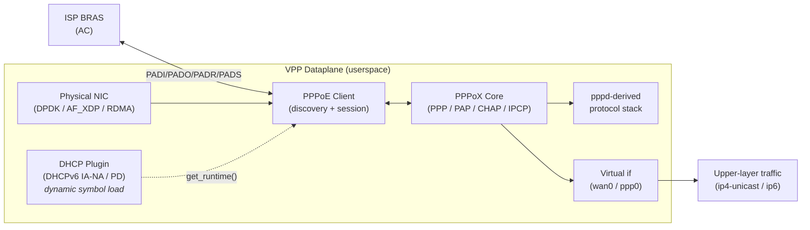

# 🚀 VPP PPPoE Client Plugin

[](https://github.com/Hi-Jiajun/vpp-pppoeclient/stargazers)
[](https://github.com/Hi-Jiajun/vpp-pppoeclient/network/members)
[](https://github.com/Hi-Jiajun/vpp-pppoeclient/releases/latest)
[](./LICENSE)

> **📄 Where is the source code?** This `main` branch holds the README, the packaging scripts and the CI workflows. **The plugin source tree lives on the [`master` branch](https://github.com/Hi-Jiajun/vpp-pppoeclient/tree/master)** — its root is `CMakeLists.txt`, `pppoeclient.c`, `pppox/`, ... mirroring the upstream VPP `src/plugins/` layout. Development happens on [`Hi-Jiajun/vpp@feat/pr-pppoeclient`](https://github.com/Hi-Jiajun/vpp/tree/feat/pr-pppoeclient/src/plugins/pppoeclient), the working branch for upstream FD.io Gerrit review.

> A userspace PPPoE client plugin for the [FD.io VPP](https://fd.io/) dataplane.
> Implements RFC 2516 discovery, session lifecycle, PAP/CHAP authentication,
> and IPv4/IPv6 address negotiation on top of VPP's vectorized packet
> processing — a single process can drive many concurrent PPPoE sessions.

🌏 [中文 README](./README.md)

---

## ✨ Highlights

- **Userspace-native**: runs entirely inside the VPP dataplane, avoiding the context-switch overhead of the classic `pppd` + kernel tunnel design
- **Single consolidated plugin**: PPPoE discovery, the PPPoX core, PAP/CHAP-MD5 (credentials up to 255 bytes), IPCP / IPv6CP are all shipped as one `pppoeclient_plugin.so`
- **VLAN / QinQ & wildcard sub-interfaces**: native single-tag VLAN, QinQ (`802.1ad`/`802.1q`), and wildcard / `default` sub-interface session VLAN auto-learning with `O(1)` bihash dispatch
- **TCP MSS clamping & MTU cap**: automatic TCP MSS correction to avoid fragmentation, plus LCP/IPCP negotiated MTU capped at `configured_mtu` (default 1492)
- **Concurrent sessions**: every PPPoE session is carried by a dedicated `sw-if-index` virtual interface, so many dial-ups run in parallel
- **DHCPv6-PD integration**: dynamically loads `dhcp` plugin's `*_get_runtime()` symbols via `vlib_get_plugin_symbol`; `show pppoe client detail` displays DHCPv6 IA-NA address and PD prefix lease state (requires the `dhcp6_*_get_runtime` export patch in the host VPP — see the prebuilt package notes)
- **Session persistence + reliable PADT**: session ID and AC MAC written atomically to a file; on exit a PADT is sent via raw AF_PACKET socket directly, independent of the VPP datapath
- **Single-step creation & live option clearing**: `create pppoe client` accepts credentials, MTU/MRU, timeout, route and DNS options in one step; `set pppoe client` supports `no-use-peer-dns` and `no-add-default-route{,4,6}` with runtime route/DNS sync
- **Observability**: `show pppoe client history` / `show pppoe client summary` / `show pppoe client detail` expose per-session state machine transitions, leases and key events
- **Backoff, jitter & rediscovery cooldown**: PADI/PADR retries use exponential backoff (cap 30s) and auth-failure / admin restarts enforce configurable `cooldown` (default 35s, range `1..300` s) to avoid reconnection storms
- **Host-Uniq-less fallback**: intelligent fallback matching when ISP does not return host-uniq
- **User-assignable interface names**: `create pppoe client ... name wan0` assigns a business-meaningful name instead of the auto-assigned `pppox0`
- **Full test suite**: [5247-line Python regression tests (97 test methods)](https://github.com/Hi-Jiajun/vpp/blob/feat/pr-pppoeclient/test/test_pppoeclient.py) covering discovery, session, auth, routes/DNS, counters and CLI
- **Performance**: 27.8 Mpps single-core PPPoE forwarding, 9.23 Gbps TCP with 4 streams on a 10G NIC — see [Performance Benchmarks](./docs/PERFORMANCE_EN.md)

## 🏗️ Architecture



- Single shared library `pppoeclient_plugin.so`; loading it enables every capability
- PAP / CHAP / LCP / IPCP are ported from `pppd` using OpenSSL `EVP_md5()`, VPP `<vppinfra/random.h>` and monotonic timers under VPP's process/graph model
- DHCPv6-PD integration loads `dhcp_plugin.so` symbols at runtime via `vlib_get_plugin_symbol`, creating no hard link-time dependency
- **Control/dataplane split**: PPPoE discovery (`pppoeclient-discovery-input`) and PPP control packets (`pppox-input`, FSM state machines and timers) hand off via `vlib_handoff` to the VPP main thread (`thread 0`), while established session forwarding (`pppoeclient-session-input` / `pppoeclient-session-output`, VLAN/QinQ encap/decap and TCP MSS clamping) runs locklessly in parallel on worker threads

## 🚀 Quick Start

### 1. Grab a prebuilt package

Pick a package for your distribution from [Releases](https://github.com/Hi-Jiajun/vpp-pppoeclient/releases/latest):

| Distro | Format | Arch |
|---|---|---|
| Ubuntu 22.04 | `.deb` | amd64 |
| Ubuntu 24.04 | `.deb` | amd64 |
| Debian 12 | `.deb` | amd64 |
| Debian 13 | `.deb` | amd64 |
| Fedora 43 | `.rpm` | x86_64 |
| Rocky Linux 9 / RHEL 9 | `.rpm` | x86_64 |

Package naming: `vpp-pppoeclient-plugins-<vpp_ref>-<distro>.<arch>.{deb,rpm}`.
`<vpp_ref>` is the nearest version tag in the VPP source used for the build (currently `v27.02-rc0`).

> **Note**: prebuilt packages are built from the plugin development branch
> [`Hi-Jiajun/vpp@feat/pr-pppoeclient`](https://github.com/Hi-Jiajun/vpp/tree/feat/pr-pppoeclient).
> That branch carries current official master plus a clean 3-commit Gerrit stack:
> the no-output TX node rename guard in `src/vnet/interface.c`, `dhcp6_*_get_runtime`
> exports in the `dhcp` plugin, and the `pppoeclient` plugin (Gerrit `45675` for DPDK is
> reviewed independently). The package filename keeps the nearest version tag (`v27.02-rc0`);
> the actual branch snapshot is recorded in the release notes, package README and package version string.
>
> **The host VPP must match**: install a `vpp` / `vpp-plugin-core` built from the same branch (or
> carrying the two host-side patches). With a plain official-FDio-master VPP the plugin still brings
> up sessions, but the DHCPv6 section of `show pppoe client detail` reports `<unavailable>` and
> renaming a no-output PPPoX interface lacks the `interface.c` guard.

### 2. Install

```bash
# Debian / Ubuntu
sudo apt install ./vpp-pppoeclient-plugins-v27.02-rc0-ubuntu24.04.amd64.deb

# Fedora / Rocky / RHEL
sudo dnf install ./vpp-pppoeclient-plugins-v27.02-rc0-fedora43.x86_64.rpm
```

The package depends on a matching VPP runtime (`vpp` / `vpp-plugin-core`) built from the same branch
(`Hi-Jiajun/vpp@feat/pr-pppoeclient`).

### 3. Bring up a PPPoE session

Assume the physical port is `GigabitEthernet0/8/0`, with credentials `user@isp` / `secret`:

```bash
vppctl

# Option A: Create and start dialling in one step (name / auth / MTU / routes / DNS)
vpp# create pppoe client GigabitEthernet0/8/0 host-uniq 1 name wan0 username user@isp password secret use-peer-dns add-default-route

# Option B: Create first, then update parameters (supports cooldown / mtu / no-* clear flags)
vpp# set pppoe client wan0 username user@isp password secret mtu 1492 cooldown 35 use-peer-dns add-default-route

# Inspect the session
vpp# show pppoe client
vpp# show pppoe client history
vpp# show pppoe client detail    # includes DHCPv6-PD lease state (requires dhcp plugin)

# Delete the session
vpp# create pppoe client GigabitEthernet0/8/0 host-uniq 1 del
```

All operator-facing actions live in the `pppoe client` CLI namespace — `create pppoe client` / `set pppoe client` / `show pppoe client ...`. The plugin drives the internal `pppox` control plane (LCP / PAP / CHAP / IPCP); operators do not need to touch `pppox` commands directly.

Full CLI surface is in [`pppoeclient.c`](https://github.com/Hi-Jiajun/vpp-pppoeclient/blob/master/pppoeclient.c) — `create pppoe client` accepts `name`, `ac-name`, `service-name`, `username`, `password`, `mtu`, `mru`, `timeout`, `use-peer-dns`, `add-default-route{,4,6}`; `set pppoe client` also supports `cooldown <1..300>`, `no-use-peer-dns`, and `no-add-default-route{,4,6}`.

## 🧱 Build from source

The plugin tree mirrors the FD.io VPP `src/plugins/` layout and can be dropped into any VPP checkout:

```bash
# Assuming an FD.io VPP checkout at ~/src/vpp
git clone -b master https://github.com/Hi-Jiajun/vpp-pppoeclient.git
rsync -a vpp-pppoeclient/ ~/src/vpp/src/plugins/pppoeclient/

cd ~/src/vpp
make install-dep
make build-release VPP_EXTRA_CMAKE_ARGS='-DVPP_PLUGINS="ppp,dhcp,pppoeclient"'
```

The resulting `build-root/.../vpp_plugins/pppoeclient_plugin.so` is ready to be loaded by VPP.

Or reuse the `fpm`-based workflow in [`scripts/build-binary-packages.sh`](./scripts/build-binary-packages.sh) to produce deb/rpm directly.

> The `master` branch mirrors the plugin sources only; the license files
> ([`LICENSE`](./LICENSE), [`NOTICE`](./NOTICE),
> [`THIRD_PARTY_LICENSES.md`](./THIRD_PARTY_LICENSES.md)) live on `main` — keep
> them alongside any source or binary redistribution.

## 🗂️ Repository layout

This repo uses a **two-branch layout** to separate packaging from code history:

| Branch | Content | Role |
|---|---|---|
| `main` (you are here) | README, LICENSE, packaging scripts, GitHub Actions workflows | Showcase + release toolchain |
| [`master`](https://github.com/Hi-Jiajun/vpp-pppoeclient/tree/master) | **The plugin source tree itself** (root contains `CMakeLists.txt`, `pppoeclient.c`, ...) | Complete development history, aligned with the upstream vpp fork |

**Want to read the actual code? Switch to the [`master` branch](https://github.com/Hi-Jiajun/vpp-pppoeclient/tree/master).** Every commit there is a real-world commit from developing pppoeclient on the upstream `Hi-Jiajun/vpp@feat/pr-pppoeclient` branch.

## 🔄 Upstream relationship

The plugin is developed on [Hi-Jiajun/vpp@feat/pr-pppoeclient](https://github.com/Hi-Jiajun/vpp/tree/feat/pr-pppoeclient/src/plugins/pppoeclient). That branch is also the working branch for upstreaming review on FD.io Gerrit.

The `master` branch here is maintained automatically by [`mirror-from-upstream.yml`](./.github/workflows/mirror-from-upstream.yml), which runs daily and:

1. Clones upstream `Hi-Jiajun/vpp@feat/pr-pppoeclient`
2. Runs `git subtree split --prefix=src/plugins/pppoeclient` to extract the plugin subtree with its history preserved
3. Force-pushes the result to `master` when new upstream commits exist, and then triggers [`auto-release.yml`](./.github/workflows/auto-release.yml) to build fresh prebuilt packages

**Net effect**: the `master` commit history equals the real sequence of commits made while developing the plugin on the vpp fork — author, date and commit message all preserved.

## 💖 Sponsor <sub>赞助</sub>

☕ If this plugin or the prebuilt packages helped you, feel free to buy me a coffee.  
<sub>如果这个插件或发布包帮到你，欢迎请我喝杯咖啡。</sub>

 

## 📜 License

The source code is licensed under [Apache-2.0](./LICENSE) — the license text is
kept verbatim, and the project attribution plus the mixed-license note live in
[`NOTICE`](./NOTICE).

The pppd-derived files under the PPPoX core retain their original BSD / mixed
licensing (`BSD-Attribution-HPND-disclaimer`, `Mackerras-3-Clause`,
`Mackerras-3-Clause-acknowledgment`).  The full notices are collected in
[`THIRD_PARTY_LICENSES.md`](./THIRD_PARTY_LICENSES.md) and match the file headers
under `pppox/pppd/` on the `master` branch word for word.

---

<sub>Built on top of [FD.io VPP](https://fd.io/). Not an FD.io official project.</sub>
